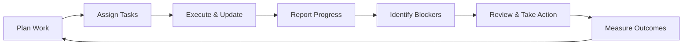
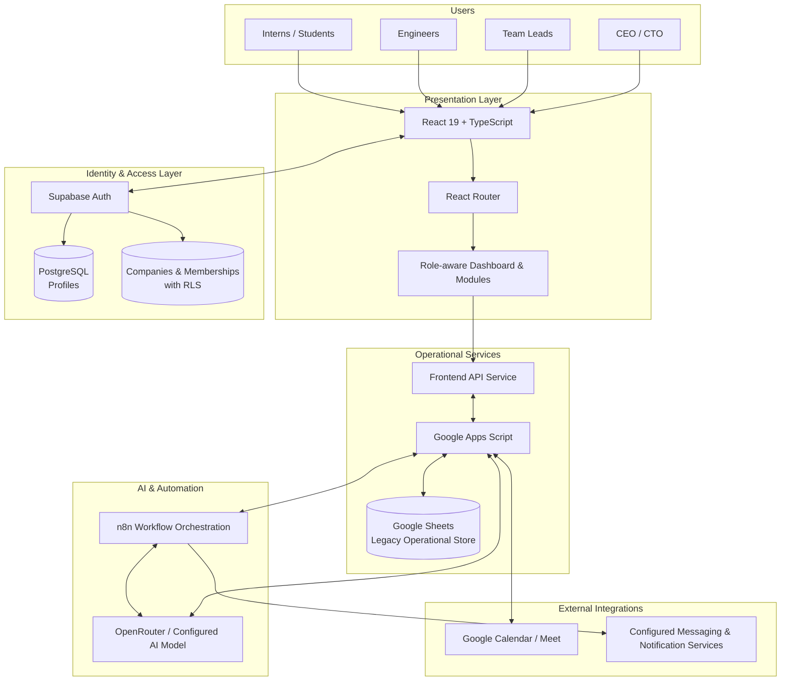
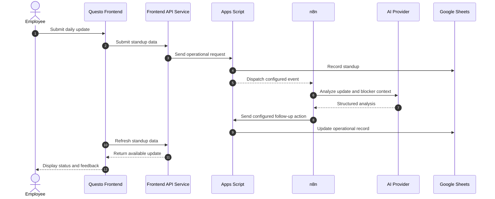

<div align="center">


# QUESTO
### Enterprise Operations & Leadership Intelligence Platform

**From fragmented team workflows to one connected operational workspace.**

A role-aware platform that brings task execution, daily standups, employee development, leave management, recruitment, meetings, and performance intelligence into a unified experience.

<br />

[](https://react.dev/)
[](https://www.typescriptlang.org/)
[](https://vite.dev/)
[](https://supabase.com/)
[](https://developers.google.com/apps-script)
[](https://n8n.io/)
[](LICENSE)

<br />

**Hackathon Project · Full-Stack Web Application · AI-Assisted Workflow Automation**

</div>

---

## Table of Contents

1. [Executive Summary](#1-executive-summary)
2. [The Problem](#2-the-problem)
3. [The Solution](#3-the-solution)
4. [Product Experience](#4-product-experience)
5. [Core Capabilities](#5-core-capabilities)
6. [System Architecture](#6-system-architecture)
7. [Key Workflows](#7-key-workflows)
8. [Technology Stack](#8-technology-stack)
9. [Repository Structure](#9-repository-structure)
10. [Local Setup](#10-local-setup)
11. [Authentication & Demo Mode](#11-authentication--demo-mode)
12. [Integrations & Automation Setup](#12-integrations--automation-setup)
13. [Build, CI & Deployment](#13-build-ci--deployment)
14. [Security & Engineering Considerations](#14-security--engineering-considerations)
15. [Current Implementation & Limitations](#15-current-implementation--limitations)
16. [Future Scope](#16-future-scope)
17. [Contributing](#17-contributing)
18. [License](#18-license)

---

# 1. Executive Summary

**Questo** is an enterprise operations and leadership intelligence platform built to simplify how teams plan work, communicate progress, coordinate people, and understand execution.

In many organizations, essential operational information is scattered across spreadsheets, chat applications, calendars, and independent task trackers. Questo brings these workflows together through a single role-aware interface, with a focus on visibility, accountability, and structured team execution.

The platform supports an organizational workflow spanning:

**CEO → CTO → Team Leads → Engineers → Interns / Students**

It combines a React and TypeScript frontend, Supabase authentication and identity management, Google Apps Script and Google Sheets operational services, and n8n-based workflow automation. AI-enabled services are integrated into selected operational workflows to assist with standup analysis, blocker assessment, meeting action extraction, roadmap generation, and management reporting.

| Dimension | Description |
|---|---|
| Product category | Enterprise operations and team management |
| Primary users | Leadership, team leads, engineers, interns and students |
| Core objective | Centralize team execution and improve operational visibility |
| User experience | Role-aware dashboard and connected workflow modules |
| Identity layer | Supabase Auth and PostgreSQL |
| Operational workflow layer | Google Apps Script and Google Sheets |
| Automation layer | n8n workflow templates |
| AI integration | OpenRouter-connected services and configured language models |
| Frontend | React 19, TypeScript and Vite |

**The central idea:** team activity should not end at task completion. Progress, blockers, decisions, meetings, leave, and employee development should form one connected operational picture.

---

# 2. The Problem

Teams frequently rely on disconnected tools to manage their day-to-day operations. A task may live in one tracker, a blocker in a chat thread, a leave request in a spreadsheet, and a meeting decision in an unstructured document.

This fragmentation creates several challenges:

### 2.1 Limited operational visibility
Leadership may not have a reliable, consolidated view of task progress, delivery risks, or team activity.

### 2.2 Reactive blocker management
Blockers can remain buried in daily updates or chat conversations until they begin affecting delivery.

### 2.3 Disconnected employee workflows
Tasks, standups, leave requests, meetings, and employee development are often managed independently.

### 2.4 Manual reporting overhead
Managers spend time collecting updates, reviewing spreadsheets, preparing summaries, and following up with team members.

### 2.5 Inconsistent growth tracking
Interns and early-career employees need clear goals, milestones, feedback, and progress indicators rather than isolated task assignments.

Questo addresses these challenges by connecting operational workflows in one structured platform.

---

# 3. The Solution

Questo provides a unified workspace where teams can manage work and review execution through role-aware experiences.

The solution is organized around five principles:

| Principle | How Questo applies it |
|---|---|
| **Visibility** | Dashboards bring tasks, updates, blockers, and team activity into view. |
| **Accountability** | Tasks have owners, priorities, statuses, deadlines, and progress information. |
| **Early intervention** | Standup and blocker workflows help surface issues for review and escalation. |
| **Employee development** | Roadmaps, milestones, XP, levels, and streaks support structured progress tracking. |
| **Workflow continuity** | Leave, meetings, reporting, and automation connect activities that are usually fragmented. |

### The operational loop



Questo is designed to make this loop visible and manageable instead of leaving each step in a separate tool.

---

# 4. Product Experience

The application includes a public product landing page, an authentication experience, and a protected internal workspace.

### 4.1 Public landing page
Introduces the platform, its capabilities, and its operational approach.

### 4.2 Role-aware workspace
The internal experience is organized around the user's role and provides access to the relevant operational modules.

Supported role types in the application include:

- `CEO`
- `CTO`
- `TEAM_LEAD`
- `ENGINEER`
- `INTERN`

### 4.3 Application navigation

| Route | Module | Responsibility |
|---|---|---|
| `/` | Landing Page | Product overview and feature presentation |
| `/login` | Authentication | User sign-in |
| `/app` | Dashboard | Role-aware operational overview |
| `/app/standups` | Standups | Daily updates and blocker reporting |
| `/app/tasks` | Tasks & Quests | Task ownership and execution tracking |
| `/app/roadmaps` | Roadmaps | Milestones and development plans |
| `/app/team` | Team | Team roster and progress visibility |
| `/app/talent` | Talent | Applicant and recruitment workflows |
| `/app/leaves` | Leave Management | Leave requests and review |
| `/app/meetings` | Meetings | Meeting coordination |
| `/app/analytics` | Analytics | Team and operational insights |
| `/app/settings` | Settings | Application preferences and integration settings |

All internal `/app/*` routes are protected by the application's authentication guard.

---

# 5. Core Capabilities

## 5.1 Leadership Dashboard

A consolidated view of operational activity designed to help leadership understand what is happening across the team.

- Task and delivery overview.
- Completed work and outstanding tasks.
- Blocker and standup visibility.
- Team activity and progress indicators.
- XP and employee growth information.
- Shortcuts to key operational modules.

## 5.2 Daily Standups & EOD Intelligence

A structured daily reporting workflow for communicating progress and identifying delivery risks.

Team members can report:

- Work completed.
- Challenges overcome.
- Current blockers.
- Planned work for the next day.

The review workflow supports:

- Reviewing recent submissions.
- Filtering updates by status and blocker state.
- Adding reviewer feedback.
- Acknowledging or unblocking reported issues.
- AI-assisted analysis through the configured service and automation layer.

## 5.3 Task & Quest Management

A task workflow that combines execution tracking with a gamified progress model.

Task information includes:

- Title and description.
- Assigned employee and email.
- Priority and status.
- Deadline and creation information.
- Tags and XP bounty.
- Completion and progress information.

The quest-based presentation is intended to make task ownership and progress easier to understand.

## 5.4 AI-Assisted Roadmaps

Roadmaps organize broader goals into milestones and actionable work.

The roadmap workflow is designed to support:

- Generating roadmap drafts from work context.
- Organizing goals into weekly milestones.
- Defining deliverables and tasks.
- Assigning XP values to work items.
- Supporting roadmap acceptance and intern workflows through the operational service layer.

Generated content should be reviewed by the responsible team member before it is used as an execution plan.

## 5.5 Team & Talent Management

Team and recruitment workflows bring employee and applicant information into the same application.

- Team roster and organizational roles.
- Employee progress indicators.
- XP, levels, and streak-related information.
- Applicant records and application details.
- Candidate status tracking.
- Reviewer feedback and resume references.

## 5.6 Leave & PTO Management

A structured workflow for submitting and reviewing leave requests.

- Submit leave and study/exam leave requests.
- Review pending requests.
- Approve or reject requests.
- Record approval details.
- Support the legacy workflow's leave-related streak protection and task rescheduling logic.

## 5.7 Meeting Coordination

Meeting workflows connect scheduling with current operational context.

- Create and manage meeting records.
- Integrate with Google Calendar and Google Meet through Apps Script services.
- Prepare meeting agendas using available blocker context.
- Support automated scheduling workflows through n8n.

## 5.8 Analytics & Performance Insights

The analytics layer is designed to help managers review execution patterns and identify areas that may need attention.

- Delivery reliability indicators.
- Standup consistency.
- Team activity and progress.
- Blocker visibility.
- XP and leaderboard-related information.
- AI-assisted performance summaries and coaching-oriented insights.

Analytics should be interpreted as operational support signals, not as a substitute for human review or employee context.

## 5.9 Workflow Automation

The repository includes n8n workflow templates for:

- Daily standup parsing and risk evaluation.
- P0 blocker escalation.
- Meeting transcript and note parsing.
- Weekly executive digest generation.
- Leave approval routing.
- Meeting scheduling and agenda preparation.

These workflows require external credentials, webhook configuration, and explicit activation in an n8n environment.

---

# 6. System Architecture

Questo follows a hybrid architecture that separates the frontend experience, user identity, operational services, and external workflow automation.

## 6.1 High-level architecture



## 6.2 Architectural responsibilities

| Layer | Technology | Responsibility |
|---|---|---|
| Presentation | React, TypeScript, Tailwind CSS | Application interface and user interaction |
| Routing | React Router | Public routes and protected application routes |
| Authentication | Supabase Auth | User sign-in and session management |
| Identity database | Supabase PostgreSQL | Profiles, companies, and company memberships |
| Frontend service layer | TypeScript API service | Operational data access and local fallback behavior |
| Operational backend | Google Apps Script | Spreadsheet-backed business workflows and web app endpoints |
| Operational persistence | Google Sheets | Legacy task, standup, leave, employee, meeting, and reporting records |
| Automation | n8n | Event-driven workflow orchestration |
| AI services | OpenRouter and configured model | AI-assisted analysis and generation |
| External services | Google Calendar / Meet and configured providers | Scheduling and connected workflow actions |

## 6.3 Identity and operational data boundary

An important architectural distinction:

- Supabase is used for authentication and core identity data.
- The current PostgreSQL migration defines profiles, companies, and company memberships.
- Existing operational workflows still use local mock data and/or the legacy Google Apps Script and Google Sheets services.
- The operational Sheets data has not yet been migrated into tenant-scoped PostgreSQL tables.

This boundary is intentional in the current implementation and is documented to avoid presenting the prototype as a fully migrated multi-tenant SaaS backend.

## 6.4 Example: standup-to-action flow



*The sequence describes the configured integration workflow. Exact execution depends on the deployed Apps Script endpoint, imported n8n workflow, credentials, and enabled triggers.*

---

# 7. Key Workflows

## 7.1 Authentication and access

1. A user opens the login page.
2. The application checks whether Supabase is configured.
3. In Supabase mode, credentials are verified through Supabase Auth.
4. The application loads the user's profile and company membership.
5. Users without a provisioned profile or company membership are denied access to the internal workspace.
6. In local demo mode, predefined demo accounts are used instead.

## 7.2 Task execution

1. A task is created with its ownership and execution details.
2. The task is assigned to a team member.
3. The assignee updates its status as work progresses.
4. Progress is reflected in the relevant application views.
5. Completion and XP-related information contribute to the team's operational picture.

## 7.3 Leave approval

The legacy operational workflow supports a leave-request lifecycle:

1. An employee submits a leave request.
2. The request is routed for review.
3. An authorized reviewer approves or rejects it.
4. When the configured approval workflow runs, leave-related streak protection and task deadline adjustments can be applied.

## 7.4 Meeting scheduling

1. A meeting request is submitted with its title, attendees, and time.
2. The configured scheduling workflow processes the request.
3. Google Calendar / Meet integration provisions the meeting when correctly authorized.
4. Available blocker context can be used to prepare an agenda.
5. Meeting information is returned to the operational workflow.

## 7.5 Weekly reporting

1. The configured n8n schedule triggers the weekly digest workflow.
2. Available operational data is collected.
3. The configured AI model assists with report synthesis.
4. The workflow writes or distributes the resulting summary through its configured integrations.

---

# 8. Technology Stack

## Frontend

| Technology | Usage |
|---|---|
| React 19 | Component-driven user interface |
| TypeScript 6 | Static typing and maintainable application logic |
| Vite 8 | Development server and production bundling |
| React Router 7 | Client-side routing |
| Tailwind CSS 3 | Utility-first styling |
| Lucide React | Icon system |
| clsx | Conditional class composition |
| tailwind-merge | Tailwind class conflict resolution |
| canvas-confetti | Interaction feedback and celebration effects |

## Identity & Data

| Technology | Usage |
|---|---|
| Supabase Auth | Authentication and session management |
| Supabase PostgreSQL | Profiles, companies, and company memberships |
| Google Sheets | Existing operational data store |
| Browser localStorage | Demo session and local operational fallback persistence |

## Automation & AI

| Technology | Usage |
|---|---|
| Google Apps Script | Serverless operational services and web app endpoints |
| n8n | Workflow automation and integration orchestration |
| OpenRouter | Configured AI model access |
| Google Calendar API / Apps Script services | Meeting and calendar workflows |
| Google Meet | Meeting link provisioning through configured calendar workflow |

---

# 9. Repository Structure

```text
QuestO/
│
├── .github/
│   ├── workflows/
│   │   └── ci.yml
│   └── PULL_REQUEST_TEMPLATE.md
│
├── frontend/
│   ├── public/
│   │   ├── favicon.svg
│   │   ├── icons.svg
│   │   └── logo.svg
│   │
│   ├── src/
│   │   ├── assets/                  # Images and static frontend assets
│   │   ├── components/              # Landing page and reusable UI components
│   │   ├── contexts/                # Authentication context
│   │   ├── layouts/                 # Protected application layout
│   │   ├── lib/                     # Supabase client configuration
│   │   ├── pages/
│   │   │   ├── app/                 # Dashboard feature modules
│   │   │   └── auth/                # Login experience
│   │   ├── services/                # API and operational data service
│   │   ├── types/                   # Shared TypeScript types
│   │   ├── App.tsx                  # Public landing page
│   │   ├── RootRouter.tsx           # Application route definitions
│   │   └── main.tsx                 # Frontend entry point
│   │
│   ├── .env.example
│   ├── package.json
│   ├── pnpm-lock.yaml
│   └── vite.config.ts
│
├── questo/
│   ├── gas/
│   │   ├── AiService.js
│   │   ├── AnalyticsService.js
│   │   ├── ApplicantService.js
│   │   ├── CalendarService.js
│   │   ├── Code.js
│   │   ├── DashboardView.js
│   │   ├── GamificationService.js
│   │   ├── InternWorkflowService.js
│   │   ├── LeaveService.js
│   │   ├── QuestoBundle.js
│   │   ├── ReportService.js
│   │   ├── SecurityService.js
│   │   ├── Setup.js
│   │   ├── StandupService.js
│   │   ├── TaskService.js
│   │   └── WebhookService.js
│   │
│   ├── n8n/
│   │   ├── workflow_blocker_alert.json
│   │   ├── workflow_leave_approval.json
│   │   ├── workflow_meeting_parser.json
│   │   ├── workflow_meeting_scheduler.json
│   │   ├── workflow_standup_agent.json
│   │   └── workflow_weekly_digest.json
│   │
│   ├── 00_5_DAY_ROADMAP.md
│   ├── 01_ARCHITECTURE.md
│   ├── 02_HLD.md
│   ├── 03_LLD.md
│   ├── 04_SECURITY_CVE.md
│   ├── 05_QUALITY_RUBRIC.md
│   └── README.md
│
├── supabase/
│   ├── migrations/
│   │   └── 202611180001_core_identity.sql
│   └── README.md
│
├── AGENTS.md
├── BRANCHING_STRATEGY.md
├── INTERNAL_APP_BUILD_PLAN.md
├── ROADMAP_5_DAYS.md
├── package.json
└── vercel.json
```

---

# 10. Local Setup

## 10.1 Prerequisites

Make sure the following tools are installed:

- Node.js 20 or a compatible current LTS release.
- pnpm 10.
- Git.
- A code editor such as Visual Studio Code.

Verify your installations:

```bash
node --version
pnpm --version
git --version
```

## 10.2 Clone the repository

```bash
git clone https://github.com/Atofinite5/QuestO.git
cd QuestO
```

## 10.3 Install frontend dependencies

The frontend package and lockfile are located in the `frontend/` directory.

```bash
cd frontend
pnpm install
```

## 10.4 Configure environment variables

Create a `.env` file inside `frontend/`:

```bash
cp .env.example .env
```

Add your Supabase project configuration:

```env
VITE_SUPABASE_URL=https://YOUR_PROJECT_ID.supabase.co
VITE_SUPABASE_ANON_KEY=YOUR_SUPABASE_PUBLISHABLE_OR_ANON_KEY
```

If you are using local demo mode, Supabase configuration can be omitted.

> **Security:** Only use the Supabase publishable/anon key in browser environment variables. Never expose a Supabase service-role key or any private integration credential in frontend code.

## 10.5 Start the development server

From the `frontend/` directory:

```bash
pnpm dev
```

Open the local URL printed by Vite in your terminal. The default Vite development address is:

```text
http://localhost:5173
```

## 10.6 Create a production build

```bash
pnpm build
```

Preview the generated build:

```bash
pnpm preview
```

---

# 11. Authentication & Demo Mode

Questo supports two authentication configurations.

## 11.1 Local demo mode

When Supabase environment variables are not configured, the application enables its built-in demo login flow.

| Role | Email | Password |
|---|---|---|
| CEO | `ceo@questo.app` | `demo` |
| CTO | `cto@questo.app` | `demo` |
| Team Lead | `lead@questo.app` | `demo` |
| Engineer | `engineer@questo.app` | `demo` |
| Intern | `intern@questo.app` | `demo` |

Demo mode is intended for local evaluation and interface exploration. It is not a production authentication mechanism.

## 11.2 Supabase authentication

To enable Supabase-backed authentication:

1. Create a project in [Supabase](https://supabase.com/).
2. Open the SQL Editor in the Supabase dashboard.
3. Apply the migration:

   ```text
   supabase/migrations/202611180001_core_identity.sql
   ```

4. Disable public sign-ups under **Authentication → Settings** for the invite-based access model.
5. Invite the initial company administrator through Supabase Auth.
6. Provision a company and its first CEO membership.
7. Invite additional users and assign their company memberships and roles.
8. Configure the frontend environment variables.
9. Restart the development server or redeploy the frontend.

A user must have a valid profile and company membership to enter the protected application.

For the complete identity setup, refer to [`supabase/README.md`](supabase/README.md).

---

# 12. Integrations & Automation Setup

The frontend can be explored independently in demo mode. The following integrations are required to enable the corresponding external operational workflows.

## 12.1 Google Sheets & Apps Script

The Apps Script source is available in:

```text
questo/gas/
```

Setup outline:

1. Create a Google Sheet for the operational workspace.
2. Open **Extensions → Apps Script**.
3. Create Apps Script files corresponding to the source files in `questo/gas/`.
4. Copy the source into the matching Apps Script files.
5. Save the Apps Script project.
6. Run the initialization function `initializeQuestoSheet()` where available in the setup source.
7. Authorize the Google services requested by the script.
8. Review the generated operational sheets and configuration.
9. Deploy the Apps Script project as a Web App when endpoint access is required.

The detailed procedure and workflow notes are maintained in [`questo/README.md`](questo/README.md).

## 12.2 AI provider configuration

The Apps Script and n8n integrations use external AI credentials.

Configure the relevant values in the appropriate secret stores:

| Configuration | Purpose |
|---|---|
| `OPENROUTER_API_KEY` | Authenticates requests to OpenRouter |
| `AI_MODEL` | Selects the configured model |
| `QUESTO_AUTH_TOKEN` | Shared token for protected integration requests |

The setup guide currently documents:

```text
AI_MODEL=deepseek/deepseek-flash
```

Store Apps Script values in **Project Settings → Script Properties**. Store n8n credentials in n8n's credential manager or environment configuration.

Never commit real keys, tokens, or credentials to the repository.

## 12.3 n8n workflows

Workflow definitions are stored in:

```text
questo/n8n/
```

| Workflow | Intended function |
|---|---|
| `workflow_standup_agent.json` | Standup parsing and risk evaluation |
| `workflow_blocker_alert.json` | P0 blocker escalation |
| `workflow_meeting_parser.json` | Meeting-note parsing and action extraction |
| `workflow_weekly_digest.json` | Weekly executive summary |
| `workflow_leave_approval.json` | Leave approval workflow |
| `workflow_meeting_scheduler.json` | Meeting scheduling and agenda preparation |

To activate a workflow:

1. Open your n8n instance.
2. Import the required JSON file.
3. Configure the credentials required by its nodes.
4. Set the Apps Script endpoint and matching authentication token where applicable.
5. Review all triggers, destinations, and permissions.
6. Test using sample data.
7. Activate the workflow only after successful verification.

Importing a workflow JSON file does not automatically configure its external credentials or activate the workflow.

---

# 13. Build, CI & Deployment

## 13.1 Production build

From the frontend directory:

```bash
pnpm install --frozen-lockfile
pnpm build
```

The production assets are generated in:

```text
frontend/dist/
```

## 13.2 Continuous integration

The repository includes a GitHub Actions workflow at:

```text
.github/workflows/ci.yml
```

The configured quality gate runs on pushes and pull requests targeting:

- `main`
- `staging`
- `develop`

The workflow performs:

1. n8n workflow JSON validation.
2. Google Apps Script JavaScript syntax checks.
3. A source scan for common hardcoded API-key patterns.
4. Frontend dependency installation using the lockfile.
5. TypeScript validation and Vite production build.

## 13.3 Vercel deployment

The repository includes a `vercel.json` configuration for the Vite frontend.

Deployment outline:

1. Import the QuestO repository into Vercel.
2. Configure the project to use the repository's supplied Vercel configuration.
3. Add the required `VITE_SUPABASE_URL` and `VITE_SUPABASE_ANON_KEY` environment variables if using Supabase mode.
4. Deploy.
5. Verify the landing page, login, protected routes, and production build.

The configured build command installs dependencies in `frontend/`, builds the Vite application, and serves the output from `frontend/dist/`.

Operational Apps Script and n8n services must be deployed and configured separately.

---

# 14. Security & Engineering Considerations

The project includes a dedicated security document:

[`questo/04_SECURITY_CVE.md`](questo/04_SECURITY_CVE.md)

Important deployment practices:

- Keep private API keys and service credentials out of frontend bundles.
- Use Supabase publishable/anon keys only in browser configuration.
- Store OpenRouter and integration secrets in server-side secret stores.
- Use a strong, randomly generated `QUESTO_AUTH_TOKEN`.
- Disable public registration when operating an invite-only workspace.
- Provision company memberships before granting internal access.
- Review Supabase Row Level Security policies and database permissions.
- Review Apps Script Web App execution identity and access scope.
- Validate incoming webhook requests and restrict integration permissions.
- Test n8n workflows with non-production data before activation.
- Avoid treating demo credentials or localStorage data as secure production identity or storage.

The repository's CI workflow includes basic secret-pattern checks. These checks are useful safeguards, but they are not a substitute for a full security audit, dependency scanning, authorization testing, or production threat assessment.

---

# 15. Current Implementation & Limitations

Questo is a working hackathon-oriented prototype with a hybrid persistence architecture. The distinction between implemented application flows and externally configured integrations is important.

| Area | Current state |
|---|---|
| React application | Implemented frontend with landing page and internal modules |
| Routing | Public and protected routes configured |
| Demo authentication | Built-in role-based demo accounts |
| Supabase authentication | Supported when environment variables and project setup are provided |
| Identity database | Migration for profiles, companies, and company memberships |
| Tasks, standups, leave and team data | Local mock/fallback data and/or legacy Apps Script/Sheets workflows |
| AI-assisted workflows | Apps Script services and n8n templates are present; external credentials and deployment are required |
| Google Calendar / Meet | Integration logic is present in the Apps Script workflow layer; Google authorization and deployment are required |
| n8n automation | Workflow templates are included; each requires configuration and activation |

### Known architectural boundary

Supabase currently manages core identity and company membership. The existing operational modules have not all been migrated to tenant-scoped PostgreSQL tables and policies.

The legacy Apps Script / Google Sheets operational store should therefore be treated as a prototype or single-company workflow layer, not as production-ready multi-tenant persistence.

### Integration dependencies

Some capabilities depend on services outside the frontend repository:

- A configured Supabase project for hosted authentication.
- A deployed Apps Script Web App for operational API access.
- A Google account and required permissions for Sheets, Calendar, and Meet workflows.
- An n8n instance with imported workflows and configured credentials.
- An OpenRouter API key and an available configured model for AI-assisted operations.

The frontend's local fallback behavior allows interface exploration without all external services being connected.

---

# 16. Future Scope

The architecture and module boundaries provide a foundation for further development. Potential next steps include:

### Platform & Data
- Migrate operational records from Google Sheets into tenant-scoped PostgreSQL tables.
- Introduce consistent tenant-level authorization across all modules.
- Add automated database and integration tests.
- Add audit history for sensitive operational actions.

### Intelligence & Automation
- Improve explainability of AI-generated risk and performance insights.
- Add human review and override controls to AI-assisted actions.
- Expand event-driven workflows and integration observability.
- Add configurable notification preferences and escalation policies.

### Product Experience
- Add richer employee development plans and milestone reviews.
- Improve analytics filters and reporting exports.
- Add onboarding guidance for new organizations.
- Improve accessibility and mobile responsiveness across workflows.

These are potential development directions, not claims about functionality already delivered.

---

# 17. Contributing

Contributions and improvements are welcome.

1. Fork the repository.
2. Create a focused feature branch.
3. Follow the existing project structure and naming conventions.
4. Keep secrets and environment files out of commits.
5. Run the frontend production build before submitting changes.
6. Validate modified Apps Script and n8n files.
7. Open a pull request with a clear explanation of the change and its testing.

Please review [`BRANCHING_STRATEGY.md`](BRANCHING_STRATEGY.md) and the pull request template before contributing.

---

# 18. License

This project declares the **MIT License** in its root `package.json`.

Ensure that the repository contains the corresponding `LICENSE` file before distributing the project under that license. Third-party libraries and assets remain subject to their own licenses.

---

<div align="center">

## QUESTO

**One workspace. Connected workflows. Clearer execution.**

Designed to bring structure, visibility, and intelligence to modern team operations.

<br />

Built with React · TypeScript · Supabase · Google Apps Script · n8n

</div>
